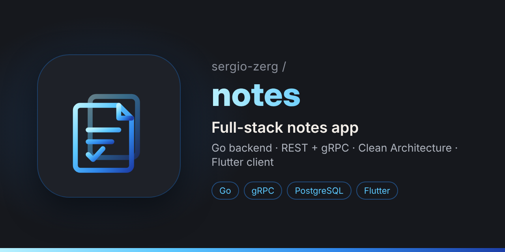
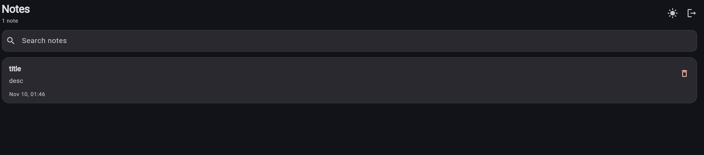
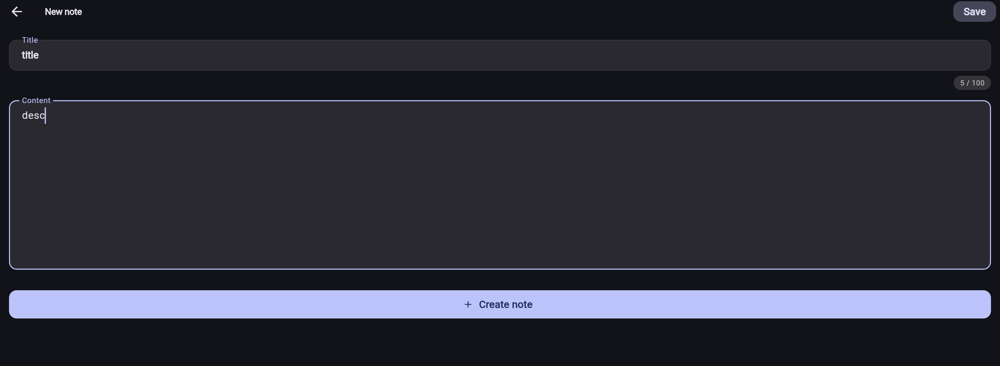
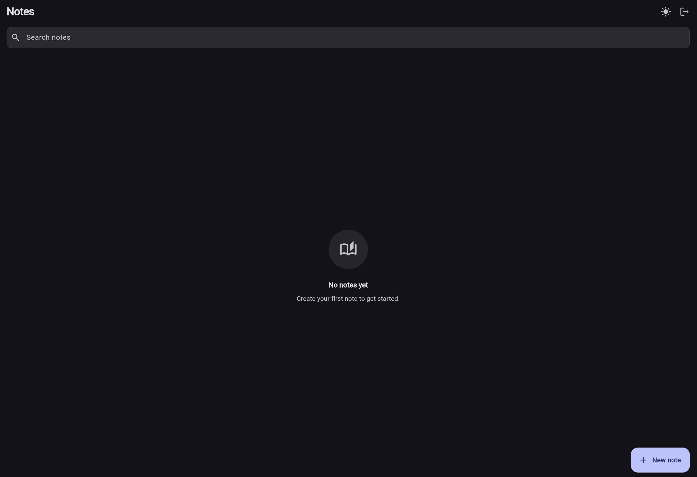
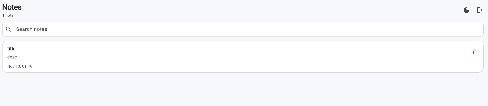

[English](README.md) | **Русский**

<p align="center"></p>

# 📝 Notes

[](https://github.com/sergio-zerg/notes/actions/workflows/ci.yml)
[](LICENSE)


Небольшое full-stack приложение для **заметок** — бэкенд на Go и клиент на Flutter.
Учебный проект, чтобы отработать чистую архитектуру, два транспорта
**REST + gRPC** и поставку как в продакшене (Docker, миграции, авторизация,
лимит запросов, наблюдаемость, CI).



## Устройство репозитория

Монорепозиторий из двух независимых частей:

| Путь | Что это |
|------|---------|
| [`backend/`](backend/README.md) | API на Go (чистая архитектура + DDD). CRUD заметок **и по REST, и по gRPC**, хранение в PostgreSQL, вход по API-ключу, лимит запросов на клиента, трассировка и метрики OpenTelemetry. |
| [`frontend/`](frontend/README.md) | Клиент на Flutter (веб / iOS / Android): вход по API-ключу, поиск, постраничный вывод, создание и правка заметок. |

## Стек

- **Бэкенд:** Go · gorilla/mux (HTTP) · gRPC · pgx + миграции goose · PostgreSQL · OpenTelemetry · лимит запросов по алгоритму token bucket
- **Клиент:** Flutter / Dart
- **Инфраструктура:** Docker и Docker Compose · CI на GitHub Actions

## Быстрый старт

Весь стек (PostgreSQL + API + веб-клиент на Flutter) поднимается одной командой:

```bash
./up.sh                 # собрать при необходимости и запустить всё
./up.sh status          # что запущено и на каких портах
./up.sh down            # остановить, база сохраняется
```

После запуска:

| Сервис | Адрес |
|--------|-------|
| Веб-клиент | http://localhost:8081 |
| REST API | http://localhost:8080 — gRPC на `:50051` |
| Метрики | http://localhost:8080/metrics |

Войдите с API-ключом по умолчанию из compose — **`dev-secret-key-change-me`** (для реального запуска задайте свой `API_KEYS`).

Запуск на машине без Docker — в [`backend/README.md`](backend/README.md).

## Авторизация и настройки

API **не запускается без `API_KEYS`**, если не задан `ALLOW_INSECURE_AUTH=true`
(только для локальных опытов), поэтому развёрнутый сервис не может молча
подняться без авторизации. Скопируйте шаблон и отредактируйте:

```bash
cp backend/.env.example backend/.env   # .env в .gitignore — настоящие секреты не попадают в git
```

Все настройки (база данных, CORS, лимиты запросов, трассировка, остановка)
описаны прямо в [`backend/.env.example`](backend/.env.example).

## Что отрабатывает проект

- **Два транспорта** — одно ядро приложения обслуживает и REST, и gRPC.
- **Чистая архитектура / DDD** — зависимости направлены внутрь; домен ничего не знает об HTTP и SQL.
- **Аккуратная поставка** — встроенные миграции, плавная остановка, вход по API-ключу, лимит запросов на клиента, ограничение размера тела, CORS.
- **Наблюдаемость** — трассировка и метрики OpenTelemetry, структурированные логи.
- **Тесты и CI** — модульные и интеграционные тесты на всех слоях, пайплайн GitHub Actions.

## Скриншоты

| Новая заметка | Пустой список | Светлая тема |
|---|---|---|
|  |  |  |

## Статус

Учебный проект — упор на архитектуру и аккуратную поставку (слои, тесты, CI,
наблюдаемость), а не на количество функций. Что готово и что дальше —
[роадмап](ROADMAP.ru.md).

## Лицензия

[MIT](LICENSE) © sergio-zerg
